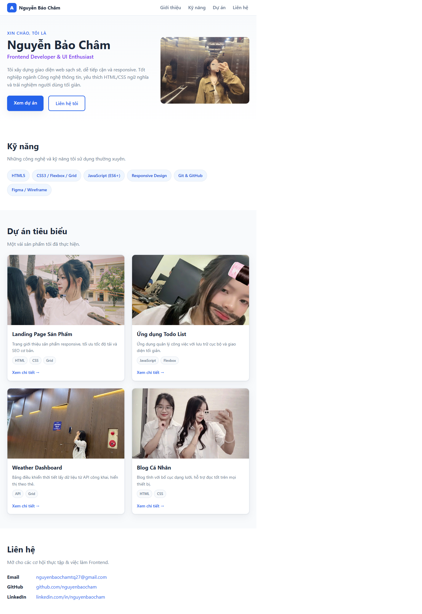
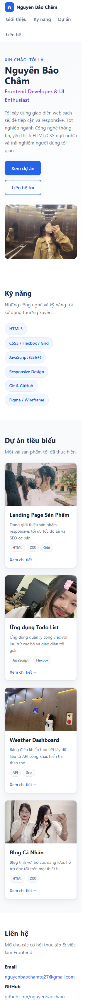

# Báo cáo kiểm thử

**Phạm vi:** Website portfolio tĩnh (`index.html`, `assets/css/styles.css` và hình ảnh trong `assets/img/`).
**Ngày kiểm thử:** 2026-10-27
**Cách kiểm thử:** Mở website bằng trình duyệt tích hợp qua `file://`, kiểm tra cấu trúc/điều hướng, trạng thái tải hình ảnh và bố cục ở kích thước cửa sổ rộng, hẹp. Ảnh chụp màn hình được lưu trong [`docs/screenshots/`](screenshots/).

## Kết quả theo tiêu chí

| Tiêu chí | Kết quả | Kết quả kiểm tra và minh chứng |
|---|---|---|
| **Tính đúng đắn** | Đạt một phần | Trang mở được; tiêu đề và các khu vực Giới thiệu, Kỹ năng, Dự án, Liên hệ hiển thị. Cả 4 liên kết điều hướng đều trỏ đến phần tử có ID tương ứng. Cả 5 ảnh trên trang tải thành công. Nội dung trang là portfolio tĩnh; các mô tả Todo List và Weather Dashboard không đồng nghĩa với chức năng ứng dụng thực tế. Các liên kết “Xem chi tiết”, GitHub và LinkedIn hiện dùng `href="#"`, nên chưa điều hướng đến đích thật. Minh chứng: [ảnh giao diện rộng](screenshots/desktop.png), [ảnh giao diện hẹp](screenshots/mobile.png). |
| **UI/UX** | Đạt một phần | Bố cục co giãn ở khung nhìn rộng 866 px và hẹp 278 px trong trình duyệt tích hợp; lưới dự án chuyển từ 2 cột sang 1 cột. Ở lần đo hẹp, chiều rộng tài liệu là 263 px, nhỏ hơn chiều rộng khung nhìn, không phát hiện tràn ngang. Menu và các mục nội dung vẫn hiển thị ở cả hai ảnh. Không kiểm thử trên thiết bị thật, các trình duyệt khác, mức thu phóng hoặc công cụ trợ năng; chưa kiểm tra breakpoint desktop 1280 px. |
| **Khả năng vận hành - xử lý lỗi** | Đạt một phần | Mở trực tiếp `index.html` bằng trình duyệt thành công, CSS và hình ảnh hiển thị. Dự án không có JavaScript, backend, biểu mẫu hay xử lý lỗi ứng dụng để kiểm thử. Chưa xác minh cách chạy qua HTTP hoặc Docker: môi trường kiểm thử không có lệnh Python và Docker khả dụng. |
| **Bảo mật** | Đạt một phần | Trong phạm vi mã nguồn đã kiểm tra, đây là trang tĩnh HTML/CSS; không thấy JavaScript, biểu mẫu nhận dữ liệu, thông tin xác thực hay yêu cầu gửi dữ liệu đến dịch vụ bên ngoài. Chưa chạy công cụ quét bảo mật, kiểm thử máy chủ/HTTP headers, kiểm thử cấu hình hosting hoặc đánh giá phụ thuộc từ bên thứ ba; kết quả này không phải chứng nhận an toàn. |
| **Chất lượng mã nguồn** | Đạt một phần | HTML dùng các phần tử ngữ nghĩa như `header`, `nav`, `main`, `section`, `article` và `footer`; có metadata cơ bản và văn bản thay thế cho ảnh. CSS dùng custom properties, Flexbox/Grid, breakpoint responsive, kiểu focus-visible và hỗ trợ `prefers-reduced-motion`. Chưa có bộ kiểm thử tự động; chưa chạy trình kiểm tra HTML/CSS hoặc công cụ phân tích chất lượng mã. |
| **Khả năng triển khai** | Đạt một phần | Cấu trúc trang tĩnh không cần bước build hay gói phụ thuộc của ứng dụng; README có hướng dẫn phục vụ bằng máy chủ cục bộ và Docker/Nginx. Trang đã được mở trực tiếp từ tệp, nhưng chưa xác nhận triển khai trên HTTP, hosting thực tế hay Docker trong môi trường này. Cần thay các liên kết mẫu và rà soát nội dung liên hệ trước khi công khai. |

## Ảnh minh chứng

### Giao diện rộng

### Giao diện hẹp

## Giới hạn kiểm thử

- Ảnh được chụp bằng trình duyệt tích hợp khi mở trang cục bộ; không đại diện cho mọi trình duyệt hoặc thiết bị.
- Chưa có kiểm thử tự động, quét bảo mật, xác minh hiệu năng hay kiểm thử triển khai trên máy chủ.
- Các liên kết placeholder và chức năng được mô tả trong thẻ dự án cần được hoàn thiện nếu kỳ vọng chúng hoạt động như sản phẩm thật.